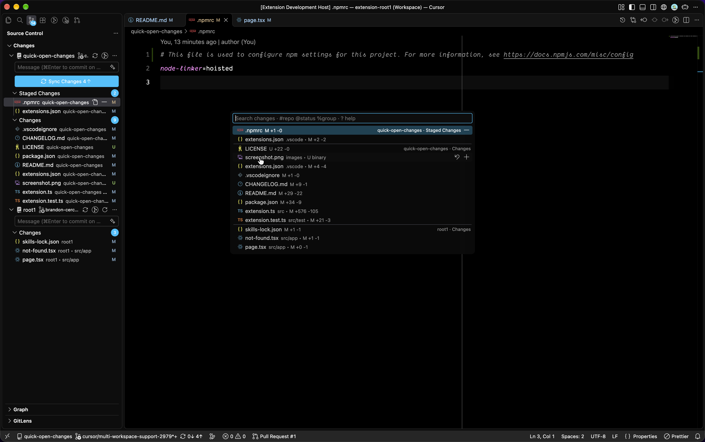

# Pick Changes

Open, stage and filter your git changes from a Quick Pick.

Forked from [Quick Open Git Status](https://github.com/aki77/vscode-quick-open-git-status) by [aki77](https://github.com/aki77).

## Usage

Press `Cmd+G` `P` (`Ctrl+G` `P` on Windows/Linux), or run **Pick Git changes** from the Command Palette. Pick a file to open it.

## Features

- **Grouped like Source Control:** Merge Changes, Staged Changes and Changes. In multi-root workspaces, all repos appear in one list.
- **Quick overview:** each row shows the file icon, name, folder, status and line counts, for example `src • M +12 -3`.
- **Inline actions:** hover over a row to stage, unstage or discard it. Discard asks for confirmation first.
- **Path search:** `src/ext` finds `src/extension.ts`. In multi-root workspaces, the path starts with the repo name, so `api/src` finds the files in `src` of the `api` repo.
- **Filters:** show only the files of a repo, status or group, with live suggestions.

Status letters: `M` modified, `A` added, `D` deleted, `R` renamed, `C` copied, `U` untracked, `!` conflict.

## Filters

| Type | Filters by | Examples                         |
| ---- | ---------- | -------------------------------- |
| `#`  | Repository | `#api`, `#web`                   |
| `@`  | Status     | `@m`, `@u`, `@!`, `@modified`    |
| `%`  | Group      | `%staged`, `%unstaged`, `%merge` |
| `?`  | Show help  |                                  |

Mix filters and text: `#api %staged @m readme`.

- Different types combine with **AND**: `#api @m` shows files in `api` **AND** modified.
- The same type combines with **OR**: `@a @u` shows files added **OR** untracked.

As you type a filter, suggestions show each matching value with its file count. Press **Tab** or **Enter** to pick one.

## Shortcut

The `Cmd+G` `P` shortcut replaces VS Code's **Find Next** (`Cmd+G`) on macOS. The `Ctrl+G` `P` shortcut replaces **Go to Line** (`Ctrl+G`) on Windows/Linux. To change it, open **Preferences: Open Keyboard Shortcuts** and search for `Pick Git changes`.

## Requirements

VS Code 1.108.0 or newer.
