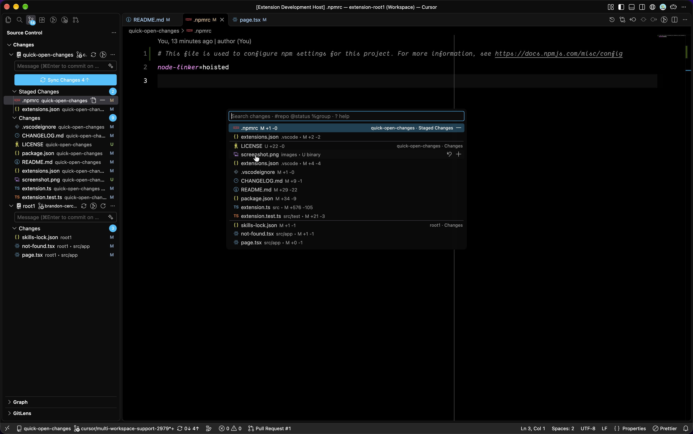

# Pick Changes

Open, stage and filter your git changes from a Quick Pick.

Forked from [Quick Open Git Status](https://github.com/aki77/vscode-quick-open-git-status) by [aki77](https://github.com/aki77).



## Usage

Press `Cmd+G` `P` (`Ctrl+G` `P` on Windows/Linux), or run **Pick Changes: All Git changes** from the Command Palette. Pick a file to open its diff, or click the **Open File** button on its row to open the file itself.

## Features

- **Grouped like Source Control:** Merge Changes, Staged Changes and Changes. In multi-root workspaces, all repos appear in one list.
- **Quick overview:** each row shows the file icon, name, folder, status and line counts, for example `src • M +12 -3`.
- **Diff view:** picking a file opens its diff, like Source Control: staged files against `HEAD`, unstaged files against the index. Deleted files open their last version; untracked files and conflicts open as plain files. Hover over a row and click **Open File** to open the file itself.
- **Inline actions:** hover over a row to stage, unstage or discard it. Discard asks for confirmation first.
- **Path search:** `src/ext` finds `src/extension.ts`. In multi-root workspaces, the path starts with the repo name, so `api/src` finds the files in `src` of the `api` repo.
- **Filters:** show only the files of a repo, status or group, with live suggestions.

Status letters: `M` modified, `A` added, `D` deleted, `R` renamed, `C` copied, `U` untracked, `!` conflict.

## Filters

| Type | Filters by | Examples                         |
| ---- | ---------- | -------------------------------- |
| `#`  | Repository | `#api`, `#web`                   |
| `@`  | Status     | `@m`, `@u`, `@!`, `@modified`    |
| `%`  | Group      | `%staged`, `%unstaged`, `%merge` |
| `?`  | Show help  |                                  |

Mix filters and text: `#api %staged @m readme`.

- Different types combine with **AND**: `#api @m` shows files in `api` **AND** modified.
- The same type combines with **OR**: `@a @u` shows files added **OR** untracked.

As you type a filter, suggestions show each matching value with its file count. Press **Tab** or **Enter** to pick one.

## Commands

| Command                                | Opens the picker with | Shortcut (macOS) | Shortcut (Windows/Linux) |
| -------------------------------------- | --------------------- | ---------------- | ------------------------ |
| **Pick Changes: All Git changes**      | no filter             | `Cmd+G` `P`      | `Ctrl+G` `P`             |
| **Pick Changes: Staged Git changes**   | `%staged`             |                  |                          |
| **Pick Changes: Unstaged Git changes** | `%unstaged`           | `Cmd+G` `U`      | `Ctrl+G` `U`             |
| **Pick Changes: Git merge conflicts**  | `%merge`              |                  |                          |

**Pick Changes: Copy Relative Path with Position** (`Cmd+G` `C` / `Ctrl+G` `C`) copies the active file's path and cursor position, like `README.md:13:12`. Lines and columns start at 1, and a tab counts as one column. In multi-root workspaces the path starts with the folder name.

To open the picker with any query, bind `pick-changes.open` with a `query` argument in `keybindings.json`:

```json
{ "key": "cmd+g t", "command": "pick-changes.open", "args": { "query": "@untracked" } }
```

## Shortcuts

The shortcuts start with `Cmd+G` on macOS, which replaces VS Code's **Find Next** (`Cmd+G`), and with `Ctrl+G` on Windows/Linux, which replaces **Go to Line** (`Ctrl+G`). To change them, open **Preferences: Open Keyboard Shortcuts** and search for `Pick Changes`.

## Requirements

VS Code 1.108.0 or newer.

## Contributing

Requires [pnpm](https://pnpm.io). Install the dependencies:

```sh
pnpm install
```

Build the extension and open this folder in a VS Code window that runs it:

```sh
pnpm dev
```

Run the tests before opening a PR (this compiles and lints first):

```sh
pnpm test
```
